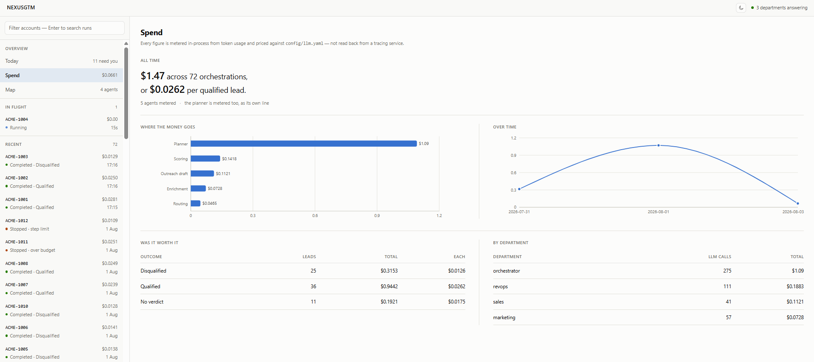
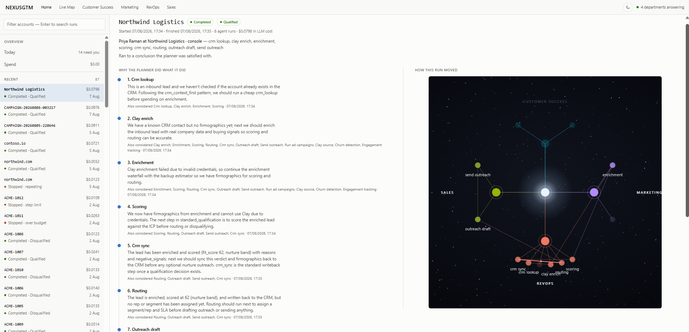
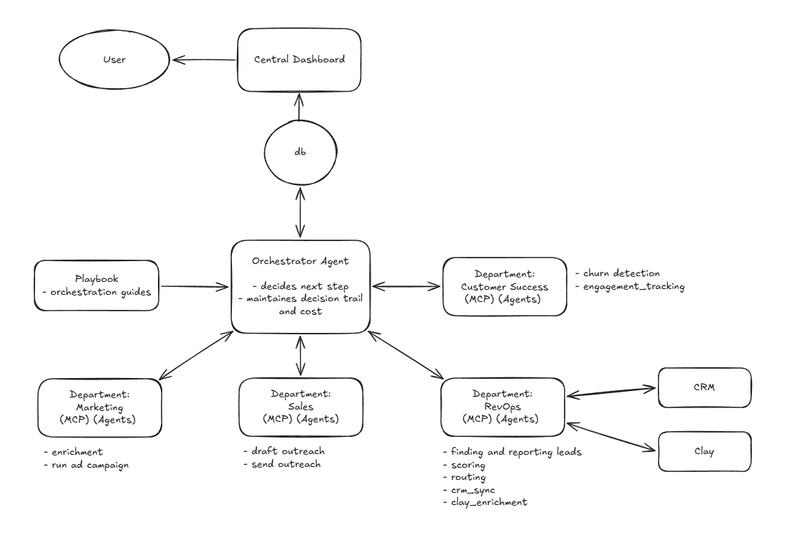

# NexusGTM — Observable GTM Agent Orchestration

NexusGTM is a full GTM solution built on an agent orchestration layer. Departments
(Marketing, RevOps, Sales, etc) run agents that hand work across department boundaries, and
a goal-directed planner sits at the center of that layer, picking the next agent at runtime
from a config-driven registry — bringing real-time flexibility and decision making to every
orchestration.

Because the path is decided at runtime, the work needs to be observable. That is what the
dashboard is for: live runs as they execute, every agent across every department, each
cross-departmental hand-off, and the LLM cost attached to it — per agent, per run, per
orchestration. Built for leadership: what the agents are doing, how work moves between
departments, and what it costs.

**[▶ Watch the demo video here](https://www.loom.com/share/a46d0ce1a4c84951b6d11d6d31bb1fde)**




## Architecture



| Piece | What it does |
|---|---|
| `core/llm.py` | The only place a provider SDK is touched. Returns text **and** token usage. |
| `core/costmeter.py` | Attributes LLM cost to the agent that spent it; rolls it up. |
| `core/agent.py` | Agent contract + the helper that exposes an agent as an MCP tool. |
| `core/registry.py` | Loads `departments.yaml`, discovers tools — the planner's action space. |
| `core/planner.py` | Renders the playbook into the prompt; returns the next routing decision. |
| `core/orchestrator.py` | LangGraph graph: plan → invoke → guardrails → plan. |
| `store/` | SQLite (WAL). Orchestrations, runs, cost events, decisions. Also the knowledge base. |
| `api/` + `dashboard/` | FastAPI JSON API, React control plane. |

New departments plug in without touching `/core`.

Example path:

```
RevOps                      RevOps                   Sales                          RevOps
  crm_lookup → clay_enrich → scoring → routing   →   outreach_draft → send_outreach → crm_sync
                    ↓ no match
              Marketing: enrichment
```

The path above is the *common* one, not a hardcoded sequence. A pre-enriched lead skips
enrichment; a disqualified lead terminates after scoring and never reaches Sales; an
outbound run starts at `clay_source` with no lead at all; a churn run starts in Customer
Success and routes on renewal risk rather than ICP fit. See [Flows](#flows).

### Cost is computed in-process

`llm_call` reads `response.usage`, which the Responses API returns inline and synchronously,
and prices it from the table in `config/llm.yaml` — so the number is available the moment the
call returns, in time for the mid-run budget guardrail.

Cost crosses the MCP process boundary in the tool result: every tool returns
`{output, status, cost_events[]}` and the orchestrator records them. Departments hold no
database handle. The planner is an LLM call too, so its spend is metered as
`orchestrator/planner`; it belongs to no single run, which is why
`orchestrations.total_cost_usd` sums `cost_events` rather than rolling up `runs.cost_usd`.

LangSmith is wired in via `wrap_openai` — every call is traced, giving a debug surface and a
base for evaluation runs over real orchestration traffic.

## Setup

```bash
uv venv --python 3.12
uv pip install -e .
uv pip install --group dev                    # pytest et al

# note: `.[dev]` does not work -- dev is a PEP 735 dependency-group, not an extra

cp .env.example .env                          # add your OPENAI_API_KEY

cd dashboard && npm install && cd ..
```

That is enough to run everything. The Clay and HubSpot agents are the one exception: they
need vendor credentials, and without them they return `status="error"`, which the planner
treats as an observation and re-plans around. To turn them on — keys, the Clay function to
build, the one-time HubSpot property setup, and why retrieved and inferred data are kept
apart — follow [docs/integrations.md](docs/integrations.md).

## Running

Six processes, each in its own terminal. The department servers must be up before the
API, or the registry starts with a partial action space (it will name what is missing).

One venv serves all five Python processes — activate it in each terminal:

```powershell
.venv\Scripts\Activate.ps1        # PowerShell
source .venv/Scripts/activate     # Git Bash
```

```bash
python -m departments.marketing.server         # :8101
python -m departments.revops.server            # :8102
python -m departments.sales.server             # :8103
python -m departments.customer_success.server  # :8104

python -m uvicorn api.main:app --port 8000     # :8000
cd dashboard && npm run dev                    # :5173  (Node — no venv needed)
```

Or skip activation and call the interpreter directly:
`.venv/Scripts/python.exe -m departments.marketing.server`.

> Config is cached per process. Editing `config/playbook.yaml` — the flows, the ICP, the
> score bands, the negative signals, `identity`, `call_policy` — means restarting all four
> department servers too, not just the API, since their agents render those values into
> their prompts. A stale `identity:` is how a live call once opened with the literal words
> "[Company Name]".

Then seed some runs and open <http://localhost:5173>:

```bash
python scripts/seed.py
```

The three seeded leads are deliberate — a standard one, a pre-enriched one, and a
free-email-domain one — so the dashboard shows three different decision trails from the
same code.

> The Vite dev server binds to `localhost`, not `127.0.0.1`. Use the former.

## Extending

Adding a department is a server plus three lines of config. Nothing under `/core` or
`/dashboard` changes; the dashboard taxonomy is built from the registry.

1. Stand up a FastMCP server whose agents subclass `core.agent.Agent` and are exposed
   with `core.agent.register`.
2. Add it to `config/departments.yaml`:

```yaml
  - id: partnerships
    name: Partnerships
    mcp_endpoint: http://127.0.0.1:8105/mcp
```

Its tools enter the planner's action space on the next discovery, and it gets a tab in the
console with no frontend edit at all.

Changing *how* the planner works is `config/playbook.yaml` — flows, patterns described as
guidance, and thresholds. It is rendered into the prompt as text, never parsed into a graph;
parsing it into branch logic would make it the fixed sequence this design exists to avoid.

### Flows

`flows:` names the scenarios the system runs. Each declares a `when` line, a goal, success
criteria, and a few patterns; `common.patterns` holds the rules that hold whichever flow is
in force.

| Flow | Starts from |
|---|---|
| `inbound_lead_qualification` | a raw lead — a form fill, a webinar, a referral |
| `outbound_sourcing` | an ICP brief, with `clay_source` producing the lead |
| `ad_campaign_response` | a live campaign's respondents, with no account yet |
| `account_expansion` | an existing customer showing an upsell signal |
| `churn_save` | an existing customer at renewal risk |

A flow is guidance and a label, never a gate: the planner sees a one-line index of every
flow plus the full detail of the current one, restates which it is working under each step,
and may switch when the state changes shape — an inbound lead that `crm_lookup` reveals to
be an existing customer. The action space stays every registered agent throughout.

A flow with a `trigger:` block gets a button on that department's tab in the console. The
trigger is also how the planner knows which scenario it is in at step one, which is why
starting a run needs no classification call.

## Voice calls

Sales can place a live phone call, not just queue an email. `voice_outreach` dials a
qualified lead with an agent that answers questions, books a meeting, and hands off to a
human; `voice_call_outcome` reads the finished call back so the planner can write it to
the CRM.

A call breaks the shape every other agent has. Agents are one-shot and synchronous, while
a conversation lasts minutes and talks back — so the call is not modelled as a function
call at all:

```
step 5  voice_outreach        dials, returns in ~1s with a call_id and no outcome
        ...                   the graph exits; the orchestration parks in `running`
        ~~~ the call happens, minutes, on the vendor's side ~~~
        POST /voice/tool-call the agent books a meeting mid-sentence (no planner)
        POST /voice/webhook   the call ended -> resume the SAME orchestration
step 6  voice_call_outcome    reads the call back, bills the minutes
step 7  crm_sync              writes the disposition against the account
```

One orchestration record, start to finish: same id, same flow, step numbers carrying on.
Blocking the tool for the call's duration was the alternative and is worse — nothing sets
a timeout on an agent call, so the hop dies mid-call and the orchestrator re-plans while
the line is still open, dialing a second time.

Three things are load-bearing and easy to mistake for incidental:

- **The reconciler.** Vendors are documented to skip the end-of-call webhook on
  transferred calls, and deliveries get dropped. A sweep over unclaimed `voice_calls`
  rows (`call_policy.reconcile_after_minutes`) is what makes the outcome *always* reach
  the planner. A call the vendor cannot account for is finalized `unknown` and resumed
  anyway — "we could not reach them" is worth recording.
- **The claim gate.** `claim_voice_followup` is a conditional UPDATE, so the webhook and
  the reconciler race freely and exactly one resumes. Without it a vendor retry runs every
  post-call step twice.
- **In-call tools are not agents.** Calendar, SMS and email live in
  `departments/sales/live_tools.py` and import nothing from `core`. The vendor's tool
  webhook blocks the conversation with a timeout of a few seconds, which a planner call
  alone exceeds.

Telephony cost is **recorded, never enforced**: a resumed run carries no budget ceiling,
because the money was spent before any ceiling could have stopped it, and halting there
would mean never recording the call. Steps stay bounded.

Nothing dials unless `VOICE_ENABLED=1`. Off, `voice_outreach` returns a synthetic
`dry-...` call id with `dry_run=true` and constructs no transport — so `pytest` and
`scripts/seed.py` place no calls. To watch the whole seam with a real planner and no
vendor account:

```bash
python scripts/voice_replay.py --list              # runs parked awaiting a call
python scripts/voice_replay.py <orchestration_id>  # fake the end-of-call report
```

Call policy — length, hours, the consent script, when to escalate — is `call_policy` in
`config/playbook.yaml`, rendered into the call's prompt rather than written into the
agent. It is top-level, not per-flow, because it renders in the sales process where the
current flow is unknowable.

## Guardrails

Every run is bounded. The table is in `core/orchestrator.py`:

| Condition | Result |
|---|---|
| spend exceeds `budget_usd` | `halted_budget` |
| step count exceeds `max_steps` | `halted_steps` |
| same agent, same input, twice | `halted_loop` |
| payload fails the agent's schema | fed back to the planner as an observation |
| tool error | retry, then re-plan, then halt |
| no suitable agent | `no_agent` |

A run resumed after a voice call is the one exception to the budget row: it carries no
ceiling, deliberately. See [Voice calls](#voice-calls).

Schema failures are fed back rather than raised on purpose: the planner's action space is
every registered agent, so it *will* sometimes pick one the blackboard cannot satisfy.
That is a re-plan, not a crash.

## Tests

```bash
pytest
```

Covers the cost rollups, the budget halt, loop detection, the step ceiling, invalid-payload
re-planning, and the decision trail. `core.llm.llm_call` is monkeypatched — no network, no
API key.

The voice tests need no telephony account either, on the same principle: `VOICE_ENABLED`
is off, and `VoiceClient` takes an injectable `transport` so the real URLs and headers are
still asserted against an `httpx.MockTransport`. The ones worth knowing about are the
redelivered webhook (resumes exactly once) and the call the vendor lost (still reaches the
planner, as an `unknown` outcome rather than an error).
