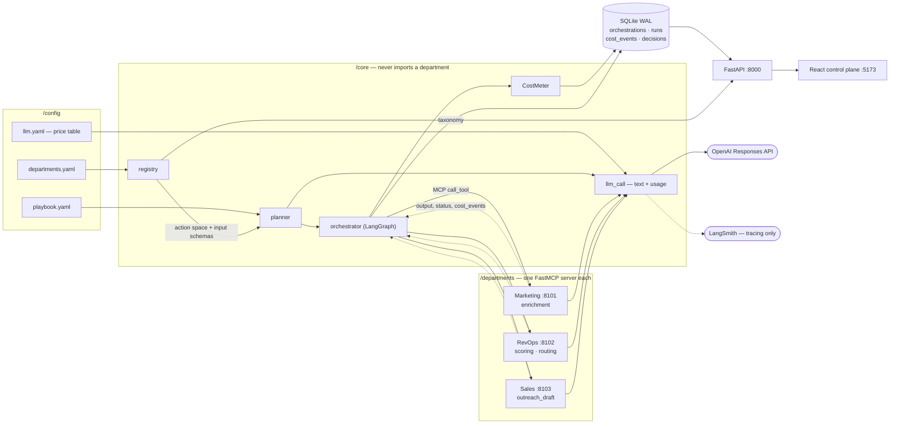
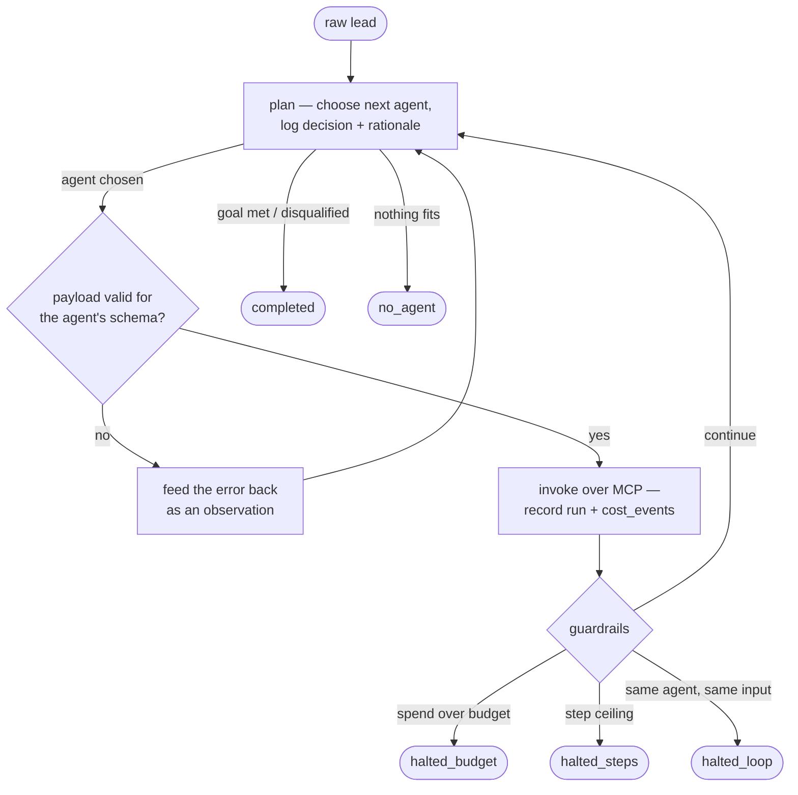
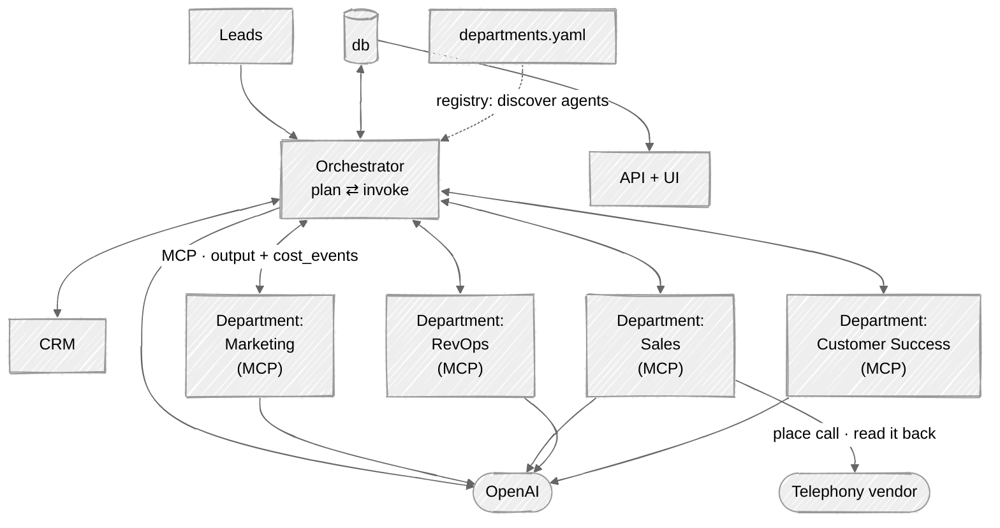
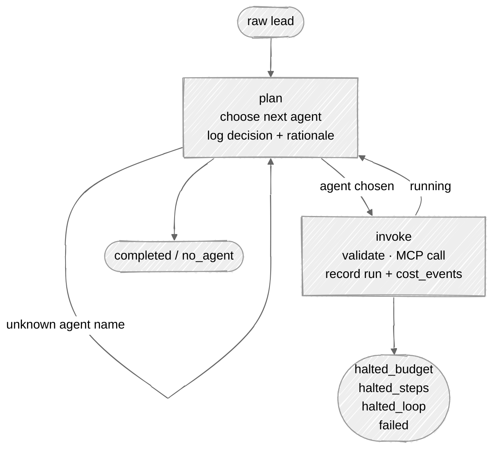
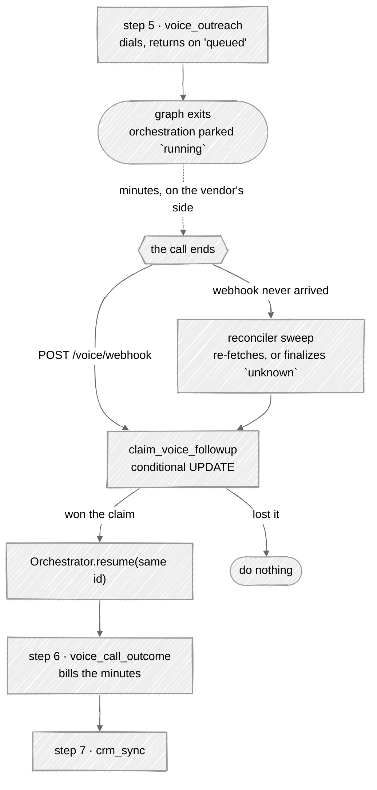

# NexusGTM — Architecture

## High-level design

Three properties the diagram is meant to make obvious:

- **`/core` has no arrow into `/departments`.** It works off the registry and MCP
  endpoints, so adding a department is a server plus a `departments.yaml` entry.
- **Cost returns on the dashed arrows.** Agents run in their own processes and hold no
  database handle, so `cost_events` ride back in the tool result.
- **LangSmith hangs off `llm_call` on a dashed edge.** Nothing reads back from it —
  cost is computed in-process from the usage the Responses API returns inline.

## The run loop

The path is chosen per run, not fixed. An invalid payload is a re-plan rather than a
crash, because the planner's action space is every registered agent — it will sometimes
pick one the blackboard cannot yet satisfy.

## At a glance

RevOps writes the verdict back through `crm_sync`, gated by `CRM_WRITE_ENABLED` — off by
default, so a seed pass reports the payload it *would* have sent rather than filling a real
portal with junk. Firmographics a model guessed are written to separate `*_inferred`
properties, never under the canonical names, so a guess can never be read back as a
retrieved fact by whoever looks at the record next.

Sales is the only department that talks to a telephony vendor, and only from
`departments/sales/clients.py` — `server.py` itself acquires no transport, which is what
keeps `send_outreach` unable to send.

## The graph as built

The run loop above is the intent; this is the actual LangGraph — two nodes, both
outbound edges conditional.

Guardrails are not a node. `_guardrail_status` runs inside `invoke`, because a status
assigned in an edge function would not survive into the graph's final state.

## A call does not fit the loop

Every agent above is one-shot: `invoke` calls it, it returns, the graph moves on. A phone
call is not — it lasts minutes and talks back. So `voice_outreach` does not model the call
as a function call at all. It dials, returns in about a second with a `call_id` and no
outcome, and the graph exits with the orchestration still marked `running`.

The run is re-entered on the original row, not forked into a second one: same
`orchestration_id`, same flow, `step_no` carrying on at 6. Cost events land under that one
id, so `orchestrations.total_cost_usd` stays additive and no parent/child rollup is needed.

Two things in that diagram are load-bearing. **The reconciler is not optional** — vendors
are documented to skip the end-of-call webhook on transferred calls, and deliveries get
dropped, so a sweep over unclaimed `voice_calls` rows is what makes "the outcome always
reaches the planner" true rather than likely; a call the vendor cannot account for is
finalized `unknown` and resumed anyway, because *we could not reach them* is still worth
recording. **The claim is a conditional UPDATE**, which is what lets the webhook and the
reconciler race freely: exactly one of them resumes, so a vendor retry cannot run the
post-call steps twice.

`_guardrail_status` still runs inside `invoke` on a resumed run, and `max_steps` is granted
relative to where the run parked rather than from zero. But `budget_usd` is `inf`: the
telephony cost arrives after the conversation already happened, so no ceiling could have
prevented it, and halting there would mean never recording the call that incurred it. The
spend is metered and reported, never enforced.

In-call tools — calendar, SMS, email — are not agents and never reach the planner. The
vendor's tool webhook blocks the conversation with a timeout of a few seconds, which a
planner call alone exceeds, so they are plain functions in
`departments/sales/live_tools.py`.
